<div align="center">
  

  # NAYRA — See Beyond. Experience More.
  **An interactive concept showcase for accessible, AI-assisted smart eyewear.**

  [View architecture](docs/ARCHITECTURE.md) · [Quality checks](.github/workflows/quality.yml) · [Submission checklist](docs/SUBMISSION_CHECKLIST.md) · [Upgrade report](docs/UPGRADE_REPORT.md) · [Scroll performance changes](docs/SCROLL_PERFORMANCE.md)
</div>


## Why NAYRA?

Navigating unfamiliar spaces, reading everyday text, and locating common objects can require additional assistance for people with visual or accessibility needs. **NAYRA explores how smart eyewear could make contextual help more natural, hands-free, and accessible.**

This repository demonstrates that product vision through a working, cinematic React application. It does **not** contain a functioning glasses firmware, computer-vision model, live speech assistant, emergency dispatch system, or validated accessibility device. Those are proposed future capabilities. The assistant responses and visual scenarios are **illustrative simulations**.

## What works today?

| Module | Implemented in this repository | Status |
|---|---|---|
| Scroll-driven product storytelling | 300 original WebP frames, HTML canvas, GSAP ScrollTrigger | Working frontend |
| Performance-aware frame delivery | On-demand nearby loading, direction-aware loading, bounded LRU (36 desktop / 18 mobile), mobile frame sampling + 960×540 assets | Working frontend |
| Three assistive scenario cards | Video posters, viewport-aware previews, accessible detail modal | Working frontend; scenarios simulated |
| Hardware concept overview | Editorial sections for camera, processor, audio, power | Illustrative hardware design |
| Conversation preview | Styled user/assistant exchange | Scripted demonstration, **no AI API** |
| Dot-matrix feature visualization | Interactive HTML canvas visualization | Visual simulation |
| Specifications / FAQ | Expandable specifications and category navigation | Working frontend; proposed specifications |
| Responsive/reduced-motion support | Media queries, native scrolling when reduced motion is preferred, reduced-motion animation fallbacks | Implemented; cross-device QA recommended |
| Camera inference / OCR / voice / SOS | Not present in this website | Planned, not working |

### Interactive product flow

1. Scroll through the animated NAYRA product introduction.
2. Open one of three use-case cards to view its narrated concept video.
3. Explore the proposed technology, assistant example, dot-matrix visuals, specifications, and FAQ.
4. Navigate the site using desktop, mobile, or keyboard controls.

## Engineering highlights

- **React 19 + TypeScript:** organized components for independent product sections.
- **GSAP + ScrollTrigger + Lenis:** synchronized cinematic scroll motion while preserving a reduced-motion path.
- **Memory-conscious hero:** frame loading is demand-driven; the loader does **not** download the whole 300-frame sequence in the background. The last displayed frame remains visible while a requested frame loads; 151 smaller mobile assets limit phone decode costs.
- **Video efficiency:** cards attach media near the viewport, automatically pause out of view, and provide WebM/MP4 source variants with static poster images.
- **Accessibility:** reduced-motion awareness, tabbed FAQ keyboard navigation, native disclosure controls, and a modal with Escape, focus containment, and focus restoration.
- **Quality guardrails:** Node test runner with unit tests, asset verification, TypeScript build, Oxlint, and GitHub Actions CI.

## Quick start

**Prerequisites:** Node.js 22 (recommended) and npm. The lockfile is committed for reproducible installations.

```bash
git clone https://github.com/chakshu-builds/Nayra.git
cd Nayra
npm ci
npm run dev
```

Vite shows the exact local URL in the terminal (typically `http://localhost:5173`). No backend service or private API keys are required to run the current experience.

| Command | Purpose |
|---|---|
| `npm run dev` | Start Vite development server |
| `npm run lint` | Check code with Oxlint |
| `npm test` | Run frame-loading unit tests |
| `npm run verify:assets` | Ensure all 300 animation frames and referenced local media exist |
| `npm run build` | Typecheck and create production `dist/` |
| `npm run preview` | Preview the production bundle |
| `npm run check` | Run lint + tests + asset verification + build |

## Project structure

```text
public/
  image/                  # Product and editorial images
  nayra-frames/           # 300 desktop WebP hero frames (1920x1080)
  nayra-frames-mobile/    # 151 sampled mobile WebP hero frames (960x540)
  Videos/                 # Optimized use-case videos and poster files
src/
  components/hero/        # Canvas-based scrollytelling
  components/layout/      # Header and footer
  components/sections/    # Use cases, architecture, assistant, specs, FAQ
  hooks/useScrollFrames.ts
  lib/frameLoader.ts      # Bounded, demand-driven media cache
  App.tsx
scripts/verify-assets.mjs
tests/frameLoader.test.mjs
.github/workflows/quality.yml
docs/
```

See [ARCHITECTURE.md](docs/ARCHITECTURE.md) for the component and media lifecycle.

## Deployment

### Vercel quick setup

1. Import the GitHub repository into Vercel and select the directory containing this `package.json` as **Root Directory**.
2. Framework preset: **Vite**. Build command: `npm run build`. Output directory: `dist`. Install command: `npm ci`.
3. Deploy; check the published URL and verify that the 300 desktop and 151 mobile frame paths return images (no 404 errors).
4. In Vercel project environment variables, set `VITE_SITE_URL` to your real public website origin for an absolute social preview, then redeploy.

Build with `npm run build` and deploy the generated `dist/` to any static host supporting SPA deployments, e.g. Vercel or Netlify. Ensure that `public/` media stays accessible at its original paths. Because desktop and mobile animation frames are shipped as static files, use a host that supports the repository's media footprint; this is **not** a zero-asset landing page.

**Social previews:** set `VITE_SITE_URL=https://your-verified-deployment.example` in the deployment environment before `npm run build`. This embeds an absolute image URL in Open Graph and Twitter metadata. Do not set `VITE_SITE_URL` to a site you do not control. It is a public URL, **not** a secret.

**Demo link:** Add your confirmed, working deployment URL here before PromptWars submission. We intentionally do not invent one.

## Evaluation evidence

| What to inspect | Evidence |
|---|---|
| Scroll animation and canvas renderer | `src/components/hero/` |
| Bounded request & memory management | `src/lib/frameLoader.ts`, `tests/frameLoader.test.mjs` |
| UI state, sections, scroll orchestration | `src/App.tsx`, `src/components/sections/` |
| Asset correctness | `scripts/verify-assets.mjs` |
| Keyboard/modal access | `src/components/sections/impact/VideoDetailModal.tsx` |
| Repeatable QA | `.github/workflows/quality.yml` |
| Product vs. working implementation | This README and `docs/ARCHITECTURE.md` |

### Constraints & honest limitations

- This is a **frontend product demonstration**, not a live multimodal AI product.
- No API credentials, cloud inference, model weights, firmware, user accounts, database, or emergency service are included.
- Web video scenarios are conceptual and **must not be used for actual navigation or personal safety**.
- Performance numbers such as Core Web Vitals, bundle size, and real device FPS should be measured on the actual deployment. We do not claim unmeasured benchmark results.
- Browser behavior differs across devices. Verify video autoplay, iOS Safari, keyboard focus, and motion settings before presenting.

## Roadmap

- [x] Cinematic product showcase and responsive sections
- [x] 300-frame hero, on-demand caching, video demonstrations
- [x] Automated loader tests and media validation
- [x] CI workflow for lint, tests, assets and build
- [ ] Real, measurable browser performance benchmarks and device QA
- [ ] User-tested accessibility evaluations
- [ ] Prototype eyewear electronics and companion software
- [ ] Secure camera/voice inference after hardware and privacy validation

## Privacy and safety

No account data is gathered and no camera/microphone permissions are requested by the present website. The visible assistant conversation is scripted. Never insert secret keys into `VITE_` variables or tracked files; browser-exposed frontend bundles cannot protect credentials.

## License

© 2026 NAYRA. All rights reserved. See [LICENSE](LICENSE). Code and media are not offered under an open-source license by default.
